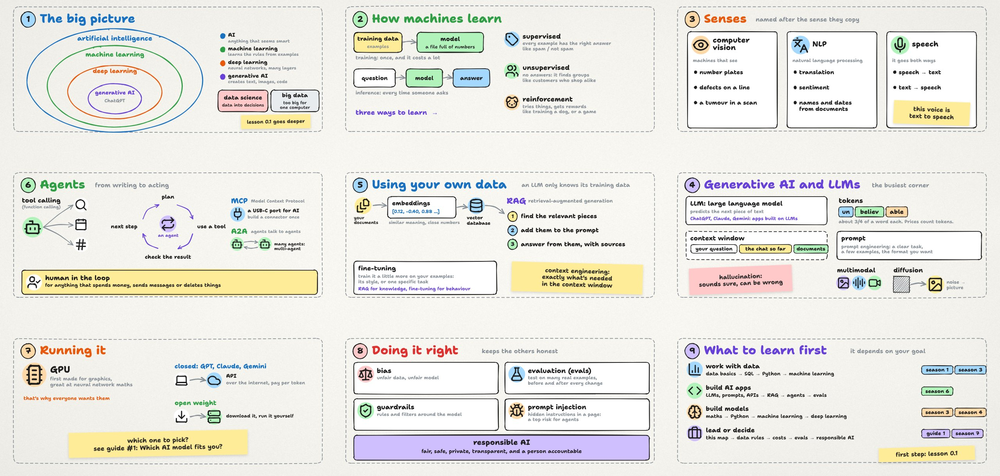

# Every AI term on one map

AI, machine learning, LLMs, RAG, agents, MCP: there's a new word every week. This guide puts about 40 of them on one map, with one line each, and ends with what to learn first for your goal.

Video: out Friday, 20 November · Notes on the website: [datalyceum.com/guides/ai-map](https://datalyceum.com/guides/ai-map/)

## 1. The big picture

AI, machine learning, deep learning and generative AI are circles inside circles.

| Term | In one line |
|---|---|
| Artificial intelligence (AI) | Any computer system that does something we'd call smart, like recognising a face or answering a question. |
| Machine learning | Instead of writing the rules by hand, we give the computer examples and it learns the rules from the data. |
| Deep learning | Machine learning with neural networks: many layers of simple maths units stacked on top of each other. Most of today's AI is deep learning. |
| Generative AI | The part of deep learning that creates new text, images, sound and code. ChatGPT lives here. |
| Data science | Turns data into answers and decisions. It sits next to the circles, not inside them. |
| Big data | The tools for data too large for one computer. |

[Lesson 0.1](https://datalyceum.com/season-0/lesson-0-1-the-map/) covers this first map in detail.

## 2. How machines learn

| Term | In one line |
|---|---|
| Training data | The examples a model learns from. |
| Model | The result of training: a file full of numbers that captures the patterns. |
| Training | Done once, and it costs a lot. |
| Inference | Using the trained model. It happens every time someone asks a question. |
| Supervised learning | Every example comes with the right answer, like emails marked spam or not spam. |
| Unsupervised learning | No answers at all. The model finds groups on its own, like customers who shop in similar ways. |
| Reinforcement learning | The model tries things and gets rewards or penalties, the way you'd train a dog or teach a program a game. |

## 3. Senses

| Term | In one line |
|---|---|
| Computer vision | Machines that see: reading number plates, spotting defects on a production line, finding a tumour in a scan. |
| Natural language processing (NLP) | Working with text: translation, sentiment, pulling names and dates out of documents. |
| Speech to text, text to speech | Turning your voice into words, and the opposite. The voice in our videos is text to speech. |

## 4. Generative AI and LLMs

| Term | In one line |
|---|---|
| Large language model (LLM) | A deep learning model trained on a huge amount of text to predict the next piece of text. ChatGPT, Claude and Gemini are apps built on LLMs. |
| Token | A piece of text, roughly three quarters of an English word. Prices and limits are counted in tokens. |
| Context window | How many tokens the model can look at in one go: your question, the conversation so far and any documents you add. |
| Prompt | What you type. |
| Prompt engineering | Writing the prompt well: a clear task, a few examples and the format you want back. |
| Hallucination | An answer that sounds sure but is wrong, because the model predicts likely text instead of looking facts up. |
| Multimodal | A model that handles more than text: images, sound, sometimes video. |
| Diffusion | A method many image generators use: start from random noise and clean it up, step by step, into a picture. |

## 5. Using your own data

| Term | In one line |
|---|---|
| Embeddings | Text turned into a list of numbers, so texts with similar meaning end up close together. |
| Vector database | Stores embeddings and finds the closest ones fast. |
| RAG (retrieval-augmented generation) | Find the most relevant pieces of your documents, add them to the prompt, and let the model answer from them, with sources. |
| Fine-tuning | Training the model a little more on your own examples, to change its style or teach it one task. RAG for knowledge that changes, fine-tuning for behaviour. |
| Context engineering | Choosing exactly what goes into the context window, so the model has what it needs and nothing more. |

## 6. Agents

| Term | In one line |
|---|---|
| Tool calling (function calling) | The model asks your code to do something, like search the web, check a calendar or run a calculation, then uses the result. |
| Agent | A model that works in a loop: plan, use a tool, check the result, decide the next step, until the job is done. |
| MCP (Model Context Protocol) | An open standard for plugging tools and data into AI apps, like a USB-C port for AI. Build a connector once, and many apps can use it. |
| A2A (Agent2Agent) | An open standard for agents to talk to other agents. |
| Multi-agent system | Several agents splitting up one job. |
| Human in the loop | A person approves anything that spends money, sends messages or deletes things. |

## 7. Running it

| Term | In one line |
|---|---|
| GPU | Chips first made for graphics, very good at the maths behind neural networks. |
| API | How apps use closed models like GPT, Claude and Gemini: send text over the internet and pay per token. |
| Open weight | Models you can download and run yourself. |

Which one to pick is the topic of [guide #1](../01-which-ai-model).

## 8. Doing it right

| Term | In one line |
|---|---|
| Bias | A model learns from data, so if the data is unfair, the model will be too. |
| Evaluation (evals) | Testing a model on many real examples before you trust it, and again after every change. |
| Guardrails | Rules and filters around the model, like blocking harmful answers or private data. |
| Prompt injection | Hidden instructions in a web page or document that try to take over your AI. One of the biggest security risks for agents. |
| Responsible AI | Fair, safe, private, transparent, and with a person accountable for the result. |

## 9. What to learn first

| Your goal | Learn in this order | In the course |
|---|---|---|
| Work with data | data basics, SQL, a bit of Python, then machine learning | Seasons 1 and 3 |
| Build AI apps | LLMs, prompts and APIs, then RAG, agents and evals | Season 6 |
| Build models yourself | maths, Python, machine learning, then deep learning | Seasons 3 and 4 |
| Lead a team or make decisions | this map, then data rules, costs, evaluation and responsible AI | Guide #1 and season 7 |

Whatever your path, [Lesson 0.1](https://datalyceum.com/season-0/lesson-0-1-the-map/) is a good first step.
