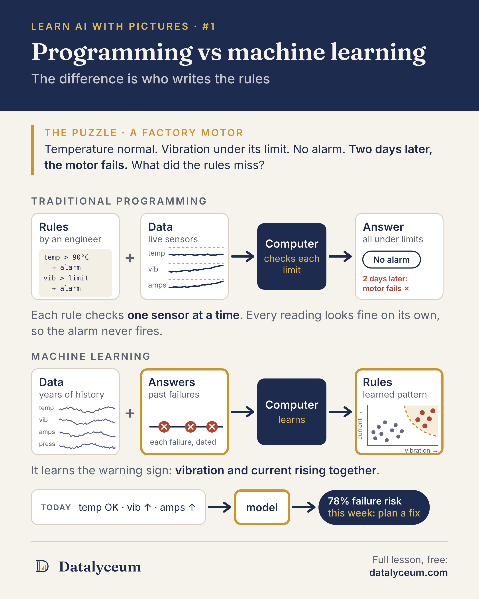

# Picture #1: Programming vs machine learning

**The puzzle.** Temperature normal. Vibration under its limit. Current under its limit. No alarm. Two days later, the motor fails. What did the rules miss?

**Traditional programming.** An engineer writes threshold rules, such as "temperature above 90 °C means alarm". Each rule checks one sensor at a time, so a failure that shows up as a combination slips through.

**Machine learning.** You give the computer years of sensor readings plus the record of past failures. It learns the warning sign no single rule could see: vibration and current rising together. The learned rules are the model, and it gives a probability, such as "78% failure risk this week" (an example figure).

**In one line.** Programming: rules + data → answers. Machine learning: data + answers → rules.

- Read the full page: https://datalyceum.com/pictures/01-programming-vs-machine-learning/
- Go deeper: [Lesson 0.1: The Map](../../seasons/00-orientation/01-the-map)
