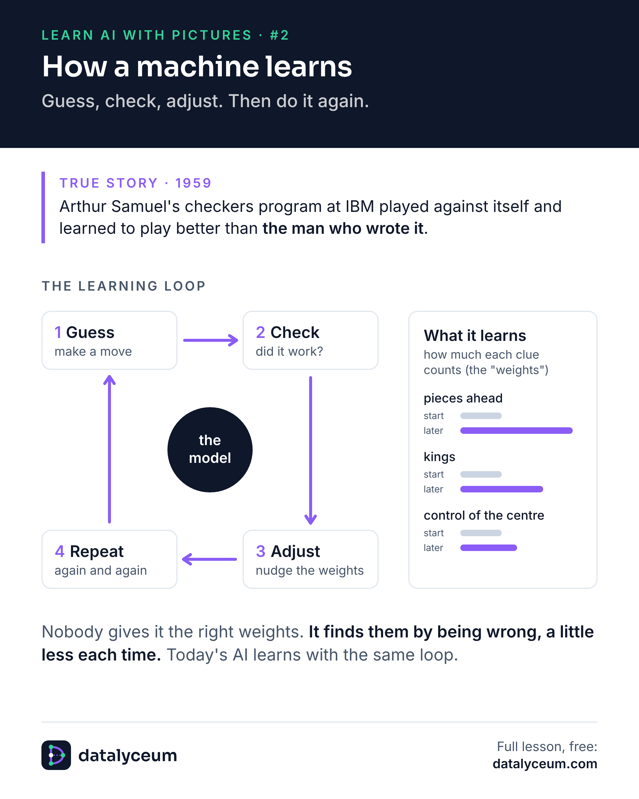

# Picture #2: How a machine learns

**True story, 1959.** Arthur Samuel's checkers program at IBM learned to play better than the man who wrote it.

**Clues, not moves.** Samuel never gave it good moves. He gave it clues to look at, such as pieces ahead, kings and control of the centre. How much each clue counts is a number called a weight, and the program had to learn those numbers.

**The loop.** Guess the weights. Check the guess by looking a few moves further ahead. Adjust the weights a little. Repeat, often playing against itself. Today's models learn with the same loop, just with far more weights. The bars in the picture are an illustration, not Samuel's real numbers.

- Watch the one-minute video: https://youtube.com/shorts/O-__d6mncdY
- Read the full page: https://datalyceum.com/pictures/02-how-a-machine-learns/
- Read the post on Substack: https://datalyceum.substack.com/p/learn-ai-with-pictures-2-how-a-machine
- Go deeper: [Lesson 0.3: How machines learn](../../seasons/00-orientation/03-how-machines-learn)

Source: A. L. Samuel, "Some Studies in Machine Learning Using the Game of Checkers", IBM Journal of Research and Development, 1959.
