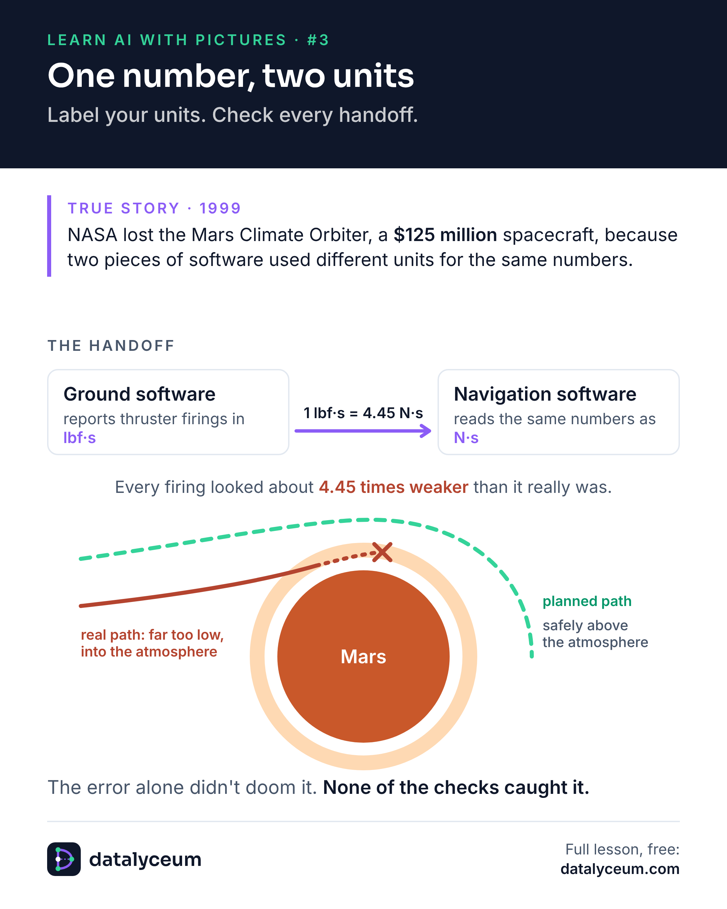

# Picture #3: One number, two units

**True story, 1999.** NASA lost the Mars Climate Orbiter, a $125 million spacecraft, at Mars.

**The handoff.** One piece of ground software reported thruster firings in pound-force seconds (lbf·s). The navigation software read the same numbers as newton-seconds (N·s), the unit the contract asked for. One pound-force second is about 4.45 newton-seconds, so every firing looked about 4.45 times weaker than it really was, and the orbiter arrived far too low.

**The real failure.** NASA said afterwards that the error itself wasn't the real failure. None of the checks caught it. Label your units, and check them every time data passes from one team to another.

- Watch the one-minute video: https://youtube.com/shorts/Wt5N-J-LO4E
- Read the full page: https://datalyceum.com/pictures/03-one-number-two-units/
- Read the post on Substack: https://datalyceum.substack.com/p/learn-ai-with-pictures-3-one-number
- Go deeper: [Lesson 1.1: Dirty data](../../seasons/01-data-foundations/01-dirty-data)

Sources: Mars Climate Orbiter Mishap Investigation Board, Phase I Report (1999); IEEE Spectrum, "Why the Mars Probe Went Off Course" (https://spectrum.ieee.org/why-the-mars-probe-went-off-course).
