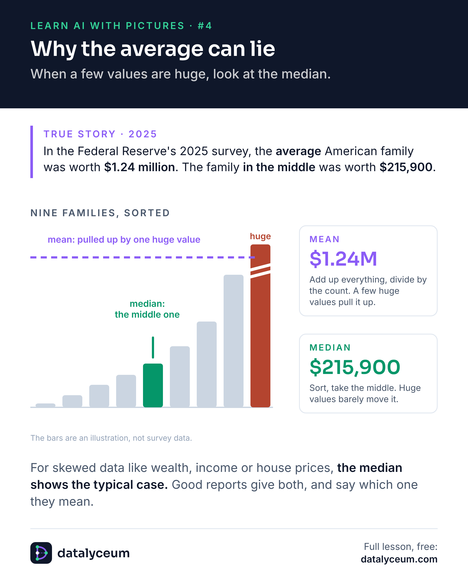

# Picture #4: Why the average can lie

**True story, 2025.** In the Federal Reserve's 2025 Survey of Consumer Finances, the average (mean) net worth of an American family was $1.24 million. The family in the middle (the median) was worth $215,900.

**Two kinds of average.** The mean adds up every family's net worth, what it owns minus what it owes, and divides by the number of families. The median sorts the families and takes the one in the middle. Both numbers are correct. They answer different questions.

**Why they differ.** A small number of very rich families pull the mean far up. The median only looks at the middle, so they hardly move it. That's why most families are worth much less than the average. For skewed data like wealth, income or house prices, the median shows the typical case better. Good reports give both, and say which one they mean. The bars in the picture are an illustration, not survey data.

- Watch the one-minute video: P04VIDEO_URL
- Read the full page: https://datalyceum.com/pictures/04-why-the-average-can-lie/
- Read the post on Substack: P04SUBSTACK_URL
- Go deeper: Lesson 1.2: Statistics 1: averages, spread and distributions (out Monday 30 November)

Sources: Federal Reserve Board, [press release on the 2025 Survey of Consumer Finances](https://www.federalreserve.gov/newsevents/pressreleases/other20261009a.htm) (9 October 2026), and [Changes in U.S. Family Finances from 2022 to 2025](https://www.federalreserve.gov/publications/files/scf26.pdf). Figures are in 2025 dollars.
