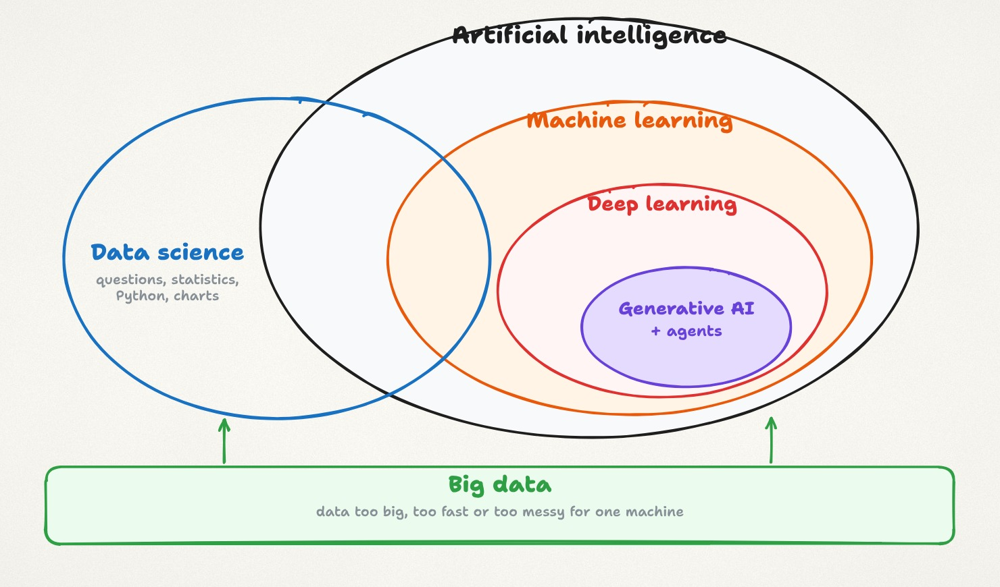
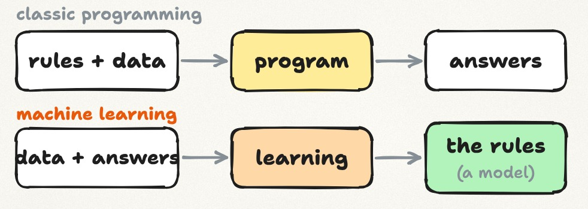
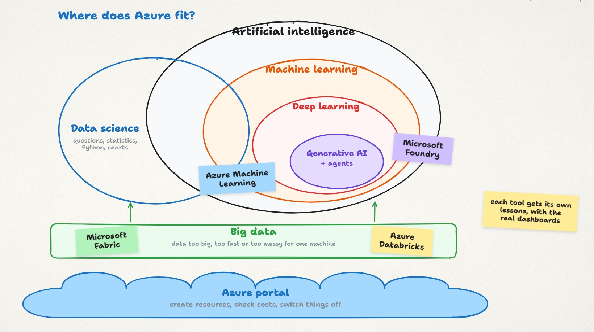

import { YouTube } from '@astro-community/astro-embed-youtube';
import LessonLinks from '../../../components/LessonLinks.astro';

<YouTube id="zhgfQalHFfs" title="Lesson 0.1: The Map" />

AI, machine learning, data science and big data get mixed up all the time, in job ads, in news articles, even in meetings between people who work with them every day. This lesson gives you one map that shows how the four fit together, and where Microsoft Azure comes in. Every lesson after this one points back to it.

The video is about 11 minutes, with audio in English, French, Spanish and Japanese (on YouTube: Settings → Audio track). These notes go a bit further than the video: common mistakes, a closer look at the Azure tools, and a short exercise.

## The map

Read the map from the inside out. Generative AI sits inside deep learning, deep learning sits inside machine learning, and machine learning sits inside AI. Data science overlaps with all of them, and big data sits underneath, feeding everything with data.

## Data science: answering questions with data

Data science is the work of answering a question with data. Say you want to sell your apartment and need a price. A data scientist collects recent sales nearby, with size, rooms, floor and final price. They fix mistakes, fill gaps and draw charts. A chart might show that every extra square metre adds about the same amount, and that a sea view adds a lot more. The answer is a price range, with the reasons behind it.

That loop of question, data, exploration and answer is the heart of data science. The tools are statistics, Python, SQL and charts. And notice that we didn't need any AI to get there. A lot of good data science is careful counting and a clear chart.

## Big data: when one machine can't keep up

A few hundred apartment sales fit in a spreadsheet. Millions of card payments every hour don't. Big data means data that is too much for one machine, in one of three ways:

- **Volume:** there is too much of it to store or process on one computer.
- **Velocity:** it arrives too fast, like sensor readings every second.
- **Variety:** it comes in many shapes at once: tables, text, images and logs.

The answer is to split the work across a cluster of computers. Apache Spark is the best-known engine for this. The data usually lands first in a data lake, cheap storage that can hold any kind of file, and is cleaned step by step into tables people can trust. Big data isn't a different goal from data science. It's the plumbing that lets data science and AI work at scale.

## AI and machine learning: from writing rules to learning them

**Artificial intelligence** is the broad goal: computers doing things that normally need human intelligence, like understanding language, recognising images or making decisions. For decades, people tried to get there by writing rules by hand. "If an email contains these words, mark it as spam." Rules work until the world changes, and spammers simply change their words.

**Machine learning** turns this around. Instead of writing the rules, we give the computer thousands of examples with the right answers, and it learns the rules itself.

Back to the apartment. The inputs (size, rooms, floor) are called **features**. The answer we want to predict (the price) is the **label**. The algorithm finds the pattern, and the result is a **model**: give it a new apartment and it predicts a price. To check that it really learned and didn't just memorise, we hide some examples during training and test the model on them afterwards.

Predicting a number, like a price, is **regression**. Predicting a category, like spam or not spam, is **classification**. Both learn from labelled examples, so they are called **supervised learning**. When there are no labels, for example grouping customers by how they shop, it's **unsupervised learning**, such as clustering.

## Deep learning, generative AI and agents

**Deep learning** is machine learning with neural networks: many layers of simple maths units, each learning something a little more complex than the layer before. In a photo, early layers find edges, later layers find shapes, and the last layers recognise whole objects. Deep learning needs a lot of data and a lot of computing power, usually GPUs, which is one reason the cloud matters so much for AI.

**Generative AI** sits inside deep learning. Earlier models predict a number or a label. Generative models create something new: text, images, code or audio. Large language models, the engines behind chat assistants, learn to predict the next word (more precisely, the next token) from huge amounts of text. Do that well enough, over and over, and you get surprisingly useful answers.

**AI agents** are the newest piece. An agent is a language model that can do more than talk: it plans steps, calls tools like search or a database, and takes actions to reach a goal. For example, it could read your support tickets, look up each customer's order, and draft replies for you to approve.

## Common confusions

**"AI and machine learning are the same thing."** Machine learning is one way to build AI, and today the most important one. But a system built only on hand-written rules can still be AI, without any learning at all.

**"Data science always uses AI."** Much of it doesn't. Many real business questions are answered with good data, careful counting and one clear chart.

**"Big data just means a lot of data."** It means more than one machine can handle, in size, speed or variety. Ten million rows in a well-run database may not be big data at all.

**"Generative AI is something separate."** It's deep learning, which is machine learning, which is AI. That's why everything you learn in the earlier seasons of this course still applies when we get to language models and agents.

## Where this lives in Azure

You don't need to remember these names yet. Each one gets its own lessons, and we open the real screens together in the hands-on track. But here is what each is for, and when you would pick it.

- **Microsoft Fabric** is one platform for analytics: storage (OneLake), data pipelines, Spark notebooks, a data warehouse and Power BI reports. Pick it when an organisation wants one managed place for data and reporting, especially if it already uses Power BI.
- **Azure Databricks** runs Apache Spark at large scale and keeps data in a lakehouse. Pick it for heavy data engineering and machine learning on Spark, or when a team already works with Databricks.
- **Azure Machine Learning** is where you train, track and deploy your own machine learning models, with tools that can try many algorithms for you. Pick it when the model has to learn from your data.
- **Microsoft Foundry** is where you choose ready-made AI models, test them, and build generative AI apps and agents on top. Pick it when you use a large pretrained model instead of training your own.
- **The Azure portal** sits underneath all of them. It's where you create resources, check costs and switch things off.

## Try it yourself (10 minutes, no code)

Think of five things you used today that might involve AI or data: your email's spam filter, your phone keyboard's word suggestions, the traffic estimate in your map app, your bank's fraud alert, a streaming app's recommendations. For each one, decide:

1. Where does it sit on the map: data science, machine learning, deep learning or generative AI?
2. Is it more likely to use rules, or to learn from examples?
3. What do you think its features and its label are?

There is no single right answer for some of them. The point is to practise using the map.

## Key terms

- **Artificial intelligence (AI):** computers doing tasks that normally need human intelligence.
- **Machine learning:** learning patterns from examples instead of hand-written rules.
- **Deep learning:** machine learning with many-layered neural networks.
- **Generative AI:** models that create new text, images, code or audio.
- **AI agent:** a language model that plans steps and uses tools to reach a goal.
- **Data science:** answering questions with data.
- **Big data:** data too large, fast or varied for one machine (volume, velocity, variety).
- **Feature:** an input the model uses. **Label:** the answer it learns to predict.
- **Regression:** predicting a number. **Classification:** predicting a category. **Clustering:** grouping without labels.

## Check yourself and practise

<LessonLinks folder="00-orientation/01-the-map" thread={3} threadText="Post where your problem sits on the map." post="https://datalyceum.substack.com/p/lesson-01-the-map" solutions />

**Question for next time:** a spam filter that learns from examples. Which circle does it belong in? We answer it at the start of Lesson 0.2.

**Next lesson:** [0.2 What is data?](/season-0/lesson-0-2-what-is-data/) Rows, columns and types, with real penguin data.

*This is an independent course, not affiliated with or endorsed by Microsoft. Microsoft and Azure are trademarks of the Microsoft group of companies.*

---

Prefer email? The same notes, plus a real-world example, are on [Substack](https://datalyceum.substack.com/p/lesson-01-the-map). Questions or homework answers go in [Discussions](https://github.com/datalyceum/course/discussions).
