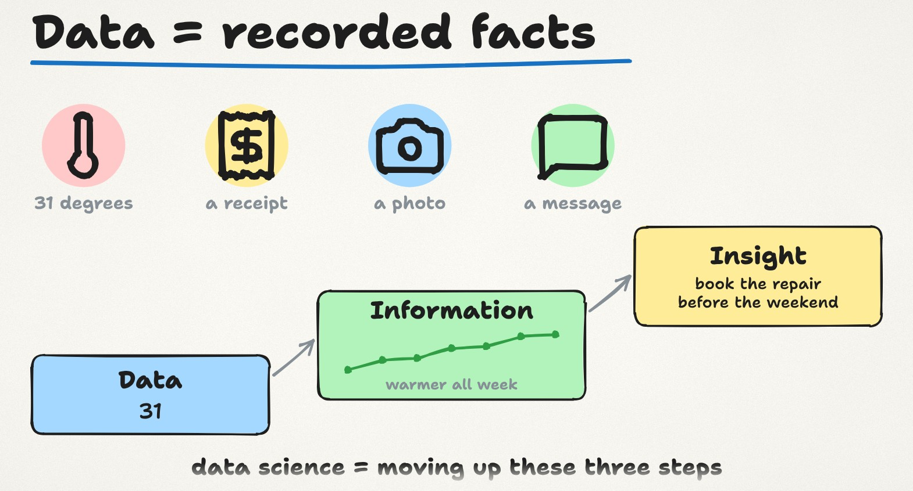
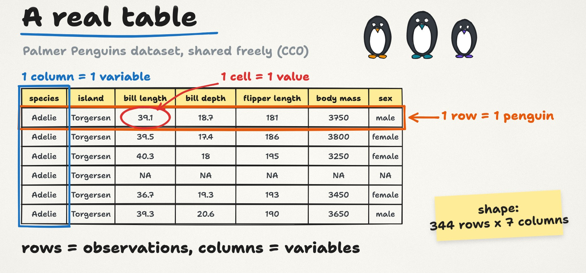
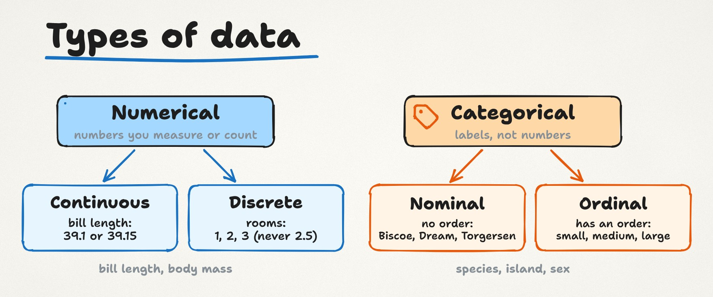
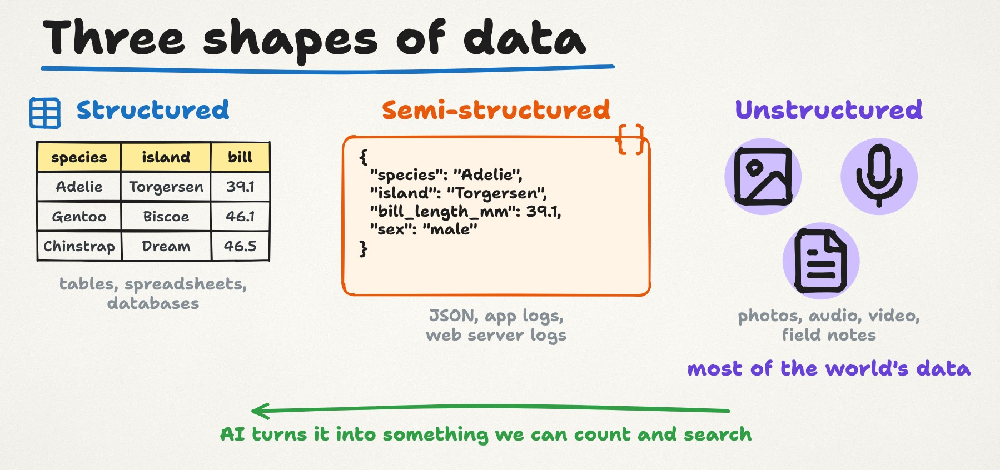
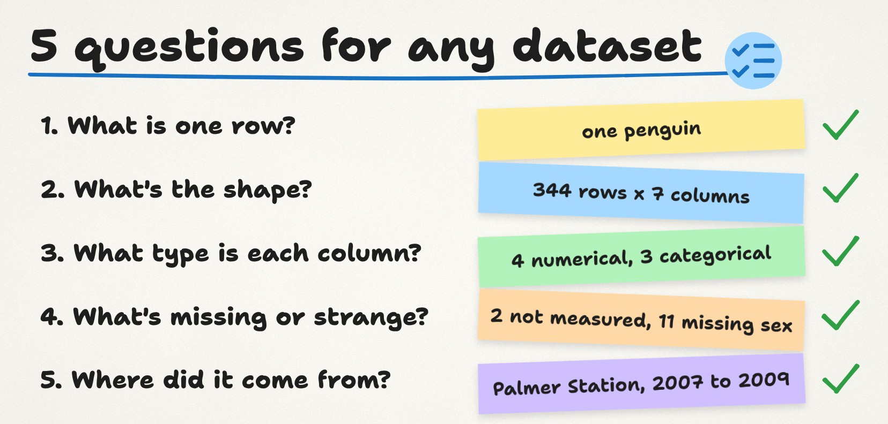
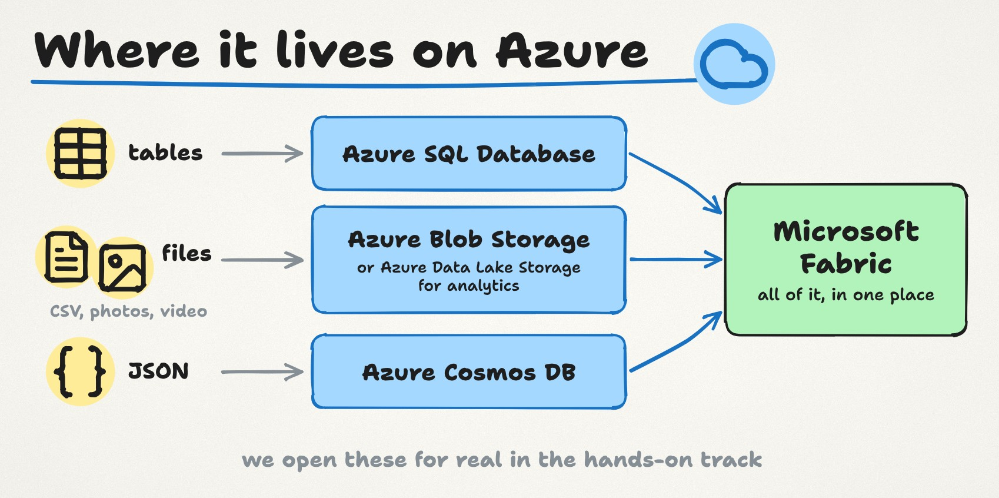

import { YouTube } from '@astro-community/astro-embed-youtube';
import LessonLinks from '../../../components/LessonLinks.astro';

<YouTube id="nUc_-USKENU" title="Lesson 0.2: What is data?" />

Every AI system you've heard of, from a spam filter to a chat assistant, is built on data. Yet most courses jump straight to models and skip the question underneath: what is data, really? In this lesson we answer it with a real dataset, 344 penguins from Antarctica, and by the end you'll be able to open a table you've never seen and read it like a data scientist.

The video is about 8 minutes, with audio in English, French, Spanish and Japanese (on YouTube: Settings → Audio track). These notes go further: common mistakes, a closer look at the Azure services, and a short exercise in a spreadsheet.

**First, last lesson's question.** A spam filter that learns from examples sits in the machine learning circle, because it learns from labelled examples. More precisely, it's classification: spam or not spam.

## Data, information, insight



Data is recorded facts about the world. Something happened, and somebody, or something, wrote it down. A thermometer reading of 31 degrees is data. So is a shop receipt, a photo on your phone and the message you sent this morning.

One number on its own tells you very little. Put many readings in order and you get information: it has been getting warmer all week. Ask the right question of that information and you get an insight you can act on: the air conditioning will be busy, so book the repair before the weekend. Data science is the work of moving up those three steps.

## Reading a real table



Most data you'll meet in this course comes as a table, so let's read a real one. The Palmer Penguins dataset was collected by scientists at Palmer Station in Antarctica between 2007 and 2009, and shared freely.

- **Each row is one observation.** Here, one row is one penguin.
- **Each column is one variable**, something recorded about every penguin: species, island, bill length, bill depth, flipper length, body mass and sex.
- **Each cell holds one value.** The first penguin is an Adelie from Torgersen island, with a bill 39.1 millimetres long.

The whole table has 344 rows and 7 columns. Data scientists call that its **shape**, and always say rows first: 344 by 7. If you remember one thing from today, make it this: rows are observations, columns are variables.

## Types of data



Not every column is the same kind of thing, and the kind decides what you can do with it.

**Numerical** variables are numbers you measure or count. Bill length and body mass are **continuous**: a bill can be 39.1 mm or 39.15 mm. The number of rooms in an apartment is **discrete**: you can have 2 or 3 rooms, never 2.5.

**Categorical** variables are labels. Species, island and sex are categorical. When the categories have no order, like the three islands, they are **nominal**. When they do have an order, like small, medium and large, they are **ordinal**.

Why it matters: you treat them differently. You can average body mass (these penguins weigh about 4.2 kg on average), but you can't average an island. Categories are counted instead: 152 Adelie, 124 Gentoo and 68 Chinstrap. Counts become bar charts. Measurements become histograms and scatter plots. Real datasets add two more common types, dates and times, and free text. We'll meet both later in the course.

## Three shapes of data



Tables are only one shape data comes in.

**Structured** data fits rows and columns: our penguin table, a spreadsheet, a database.

**Semi-structured** data has labels but no fixed table. Here is the first penguin written as JSON, the format most web apps use to send data to each other:

```
{
  "species": "Adelie",
  "island": "Torgersen",
  "bill_length_mm": 39.1,
  "sex": "male"
}
```

Logs from apps and web servers look like this too. Each record can carry different fields, which makes it flexible and a bit harder to analyse.

**Unstructured** data has no ready-made fields at all: photos, audio, video and free text like a scientist's field notes. Most of the world's data is unstructured, and a big part of modern AI, from image recognition to language models, exists to turn it into something we can count and search.

## Where data comes from, and why it's never perfect

Data mostly comes from four places: **people** (forms and apps), **machines** (sensors and server logs), **transactions** (card payments) and **open data** shared by governments and scientists, like these penguins.

How data was collected decides how good it is. Look closely at the penguins: two have no measurements at all, and eleven have no value for sex. Real data always has gaps like these. Spotting them is the first job of any data scientist, and fixing them is where Season 1 begins.

## Five questions for any dataset



Here's a habit worth keeping. Whenever you open a new dataset, ask it five questions:

1. What is one row? (one penguin)
2. What's the shape? (344 by 7)
3. What type is each column? (four numerical, three categorical)
4. What's missing or strange? (two penguins not measured, eleven missing values for sex)
5. Where did it come from, and who collected it? (Palmer Station, 2007 to 2009)

Two minutes, and you'll avoid most beginner mistakes before they happen.

## Common confusions

**"If it's a number, it's numerical data."** Not always. A postcode, a phone number or a product ID is written with digits, but it's a label. Nobody averages postcodes. Ask yourself whether adding or averaging the values would mean anything.

**"A missing value is a zero."** An empty cell means "we don't know", not "nothing". If you treat the two unmeasured penguins as weighing 0 g, the average drops from 4,202 g to 4,177 g, and the error grows with every gap.

**"Unstructured means messy."** It only means there are no ready-made fields. A photo can be perfectly sharp and clean and still be unstructured.

**"Ordinal categories are just numbers."** Survey answers from 1 to 5 look numerical, but the step from "agree" to "strongly agree" isn't a measured distance. People do average them, but it's worth knowing that you're making an assumption when you do.


## A closer look at Azure



You don't need to remember these yet. We open each one for real in the hands-on track. But here is what each is for, and when you'd pick it.

- **Azure SQL Database** is a managed relational database: tables with rows, columns and fixed types, queried with SQL. Pick it for application data that must stay consistent, like orders, customers and bookings.
- **Azure Blob Storage** stores files of any kind, from CSV files to photos and videos, cheaply and at almost any size, with cheaper tiers for data you rarely touch. Pick it when you need to keep files, not query them.
- **Azure Data Lake Storage** is Blob Storage with a real folder structure and permissions built for analytics. Pick it when the files will feed Spark, pipelines or a lakehouse.
- **Azure Cosmos DB** stores semi-structured documents like JSON, and answers fast from anywhere in the world. Pick it for apps whose records don't all have the same fields, like product catalogues or user profiles.
- **Microsoft Fabric** brings all of these together for analysis, with one data lake (OneLake), pipelines, notebooks and Power BI reports. Pick it when you want one place to analyse data that lives in many places.

Everything in this lesson is also part of the Azure Data Fundamentals certification, in the section on core data concepts.

## Try it yourself (10 minutes, no code)

Download penguins.csv (link below) and open it in Excel, Google Sheets or LibreOffice Calc.

1. Scroll to the bottom. The last row is row 345, because row 1 holds the column names. That's 344 penguins.
2. Write next to each column name whether it's numerical or categorical.
3. Find the two penguins with no measurements. Hint: filter body_mass_g for empty cells. They are in rows 5 and 341.
4. In an empty cell, type `=AVERAGE(F2:F345)`. You should get about 4,202 g. The spreadsheet skips empty cells, which is what we want here.
5. Count one species with `=COUNTIF(A2:A345,"Gentoo")`. You should get 124.

You've just answered three of the five questions with a spreadsheet.

## Key terms

- **Data:** recorded facts about the world.
- **Observation (row):** one thing measured, here one penguin. **Variable (column):** one thing measured about every observation.
- **Shape:** rows by columns, rows first.
- **Numerical, continuous:** measured, any value. **Numerical, discrete:** counted, whole numbers.
- **Categorical, nominal:** labels with no order. **Categorical, ordinal:** labels with an order.
- **Structured, semi-structured, unstructured:** tables; labelled records without a fixed table (JSON, logs); no ready-made fields (photos, audio, video, free text).
- **Missing value:** an empty cell. Unknown, not zero.

## Check yourself and practise

<LessonLinks folder="00-orientation/02-what-is-data" thread={4} threadText="Post your five answers for a dataset you care about." post="https://datalyceum.substack.com/p/lesson-02-what-is-data" notebook="explore-penguins.ipynb" notebookText="The five questions in a few lines of Python. Optional." data solutions />

**Question for next time:** if a penguin's body mass is missing, should you delete that penguin, or fill in a guess? We come back to it in Season 1.

**Next lesson:** [0.3 How machines learn](/season-0/lesson-0-3-how-machines-learn/). We use these same penguins to train a first model.

*Data: Palmer Penguins, collected by Dr. Kristen Gorman and the Palmer Station LTER program, CC0 (Horst, Hill and Gorman, 2020). This is an independent course, not affiliated with or endorsed by Microsoft. Microsoft and Azure are trademarks of the Microsoft group of companies.*

---

Prefer email? The same notes, plus a real-world example, are on [Substack](https://datalyceum.substack.com/p/lesson-02-what-is-data). Questions or homework answers go in [Discussions](https://github.com/datalyceum/course/discussions).
