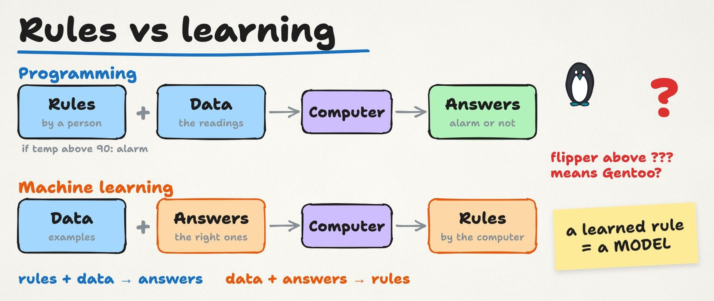
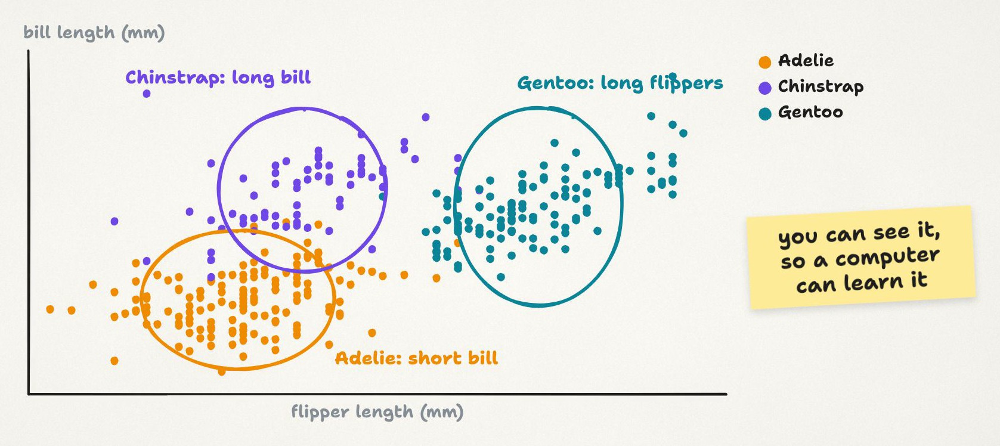
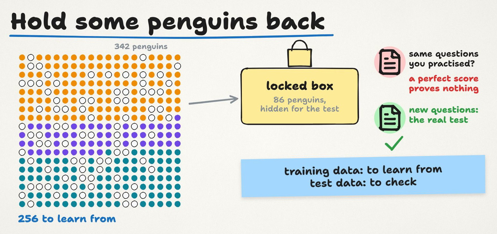
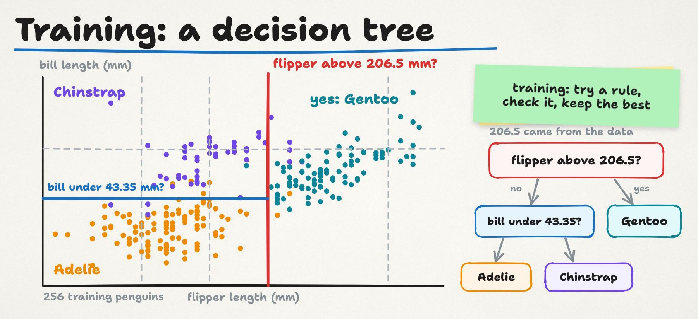
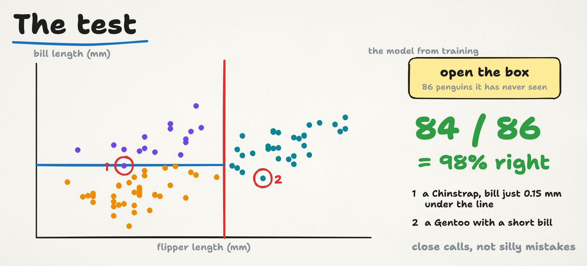
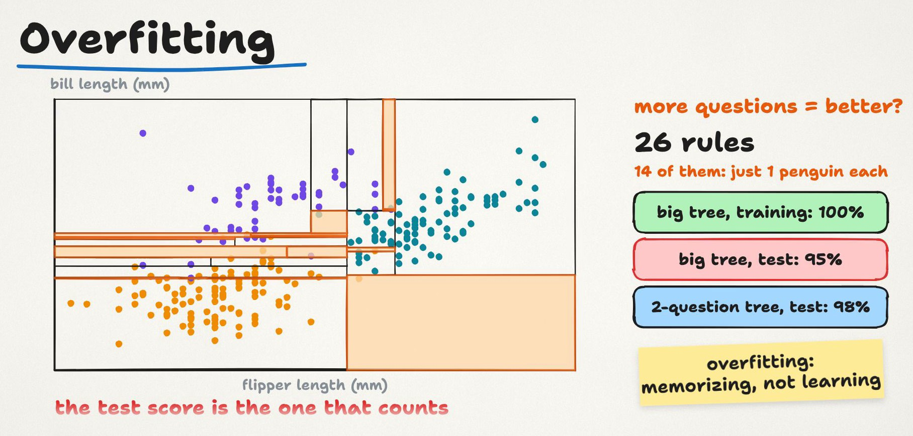
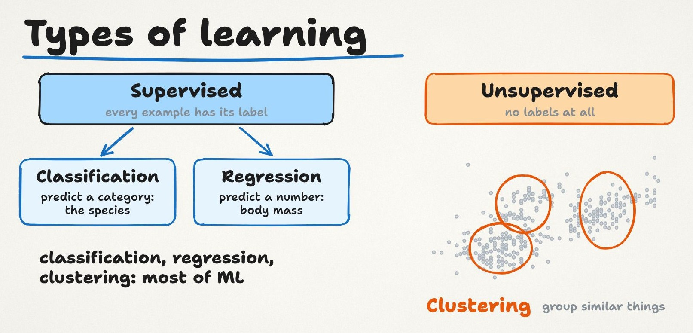
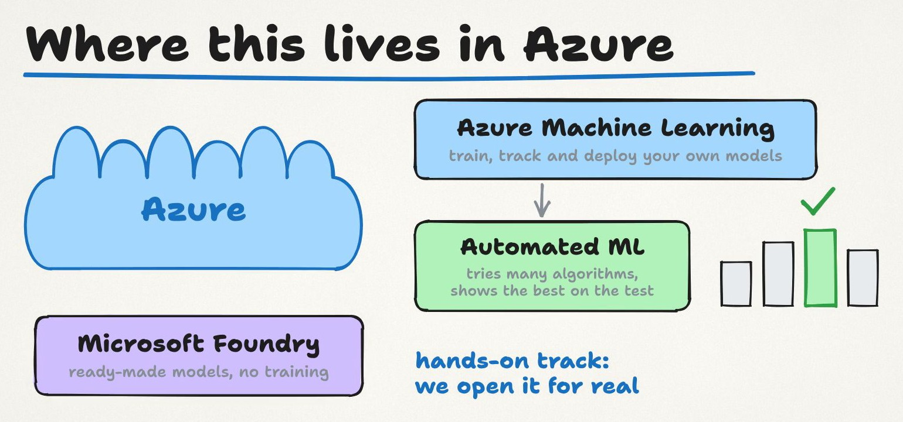

import { YouTube } from '@astro-community/astro-embed-youtube';
import LessonLinks from '../../../components/LessonLinks.astro';

<YouTube id="-Ct6_TzkdGw" title="Lesson 0.3: How machines learn" />

In 1959, an IBM engineer named Arthur Samuel wrote a checkers program that ended up playing better than he did. Nobody typed in a winning strategy. The program played, kept track of what worked, and adjusted. His paper gave the idea the name we still use: machine learning. [Picture #2](/pictures/02-how-a-machine-learns/) tells his story in one picture.

In this lesson you'll watch that idea work on real data. We take the penguins from Lesson 0.2, teach a computer to tell three species apart from two measurements, and then check, honestly, how well it learned. No code needed.

The video is about 9 minutes, with audio in English, French, Spanish and Japanese (on YouTube: Settings → Audio track). These notes go further: the mistakes beginners make, a closer look at the Azure services, and a ten-minute exercise where you train a model by hand.

**First, last lesson's question.** If a penguin's body mass is missing, should you delete that penguin or fill in a guess? There's no single right answer. It depends on how many values are missing and why, and Season 1 is all about it. Today we take the simple route: two penguins have no measurements at all, so we leave them out. That leaves 342.

## Rules vs learning

Normal software runs on rules that people write. If the motor temperature is above 90 degrees, raise an alarm. That works when somebody already knows the rule.

Now try writing a rule that tells penguin species apart. Which measurement do you use? Which number? You'd have to study the data and guess.

Machine learning turns this around. You don't write the rule. You give the computer examples with the right answers, and it finds the rule itself.

- **Programming:** rules + data → answers
- **Machine learning:** data + answers → rules

The rule it finds is called a **model**. The rest of this course is built on that word.

## Features and label

Every machine learning problem starts with two questions. What do we know, and what do we want to predict?

What we know are the **features**. Here we use two measurements: bill length and flipper length. What we want to predict is the **label**: the species, Adelie, Chinstrap or Gentoo.

Put every penguin on a chart, flipper length across and bill length up, one dot per penguin coloured by species, and you can already see three groups. Gentoos sit on the right, with long flippers. Adelies sit bottom left, with short bills. Chinstraps sit top left, with long bills.

If you can see a pattern, a computer can learn it. Our job is to check that it learns it properly.

## Hold some data back

Before training, we hide 86 penguins, about a quarter of them, in a locked box. They're picked at random, but with the same mix of species as the whole dataset. The computer learns from the other 256.

Why bother? Think of an exam. If the exam uses the same questions you practised, a perfect score proves nothing, because you might have memorised the answers. The hidden penguins are the exam with new questions. They tell us how the model will do on penguins it has never seen.

**Training data** to learn from, **test data** to check. Every real project works this way.

## Training a decision tree

We use one of the simplest kinds of model, a **decision tree**. It learns a few yes-or-no questions.

To find the first question, it tries many possible lines across the chart and keeps the one that separates the species best. Here's what it found: is the flipper longer than 206.5 mm? If yes, it's almost always a Gentoo. That one question gets the Gentoo-or-not decision right for 334 of the 342 penguins.

Then it asks about the bill. For short flippers, a bill of 43.35 mm or less means Adelie, and a longer bill means Chinstrap.

Two questions, and the chart is split into regions. That's the whole model. Nobody told it 206.5. It found that number in the data. (Trees put each line halfway between two neighbouring values in the training data, which is why the numbers look so precise.)

That's what training means: try a rule, check how well it separates the examples, keep the best one, repeat.

## The test: 84 of 86

Now we open the box and show the model the 86 penguins it has never seen. It gets 84 right, which is 98%.

The two mistakes are worth a look:

1. A Chinstrap with a 43.2 mm bill. The line is at 43.35, so it missed by 0.15 mm and was called an Adelie.
2. A Gentoo with long flippers but an unusually short bill, 40.9 mm. The tree has one more bill question on the long-flipper side: 41.25 mm or less means Adelie. That rule exists because of a single long-flippered Adelie in the training data, and it caught this Gentoo.

Close calls, not silly mistakes. So yes: from two measurements, a simple model can tell three penguin species apart, on penguins it has never seen.

## Overfitting

Here's the trap every beginner falls into. If two questions work well, wouldn't more be better?

We let the tree grow as big as it liked. It ended up with 26 rules, and 14 of them exist for just one penguin each. On the training penguins it scored a perfect 100%. On the hidden penguins it dropped to 95%, worse than our two-question model.

It memorised the training data, quirks and all, instead of learning the pattern. That's called **overfitting**. A perfect score on data the model has already seen means very little. The test score is the one that counts.

## Types of learning

What we did today has a name. Every example came with its answer, the label, so it's **supervised learning**.

- Predicting a category, like the species, is **classification**.
- Predicting a number, like a penguin's body mass from its flipper length, is **regression**.

Sometimes there are no labels at all. The computer can still group similar things together: hide the species names and it can still find groups of penguins that look alike. That's **clustering**, a kind of **unsupervised learning**.

Classification, regression, clustering. Most of the machine learning you'll meet is one of these three.

## Common confusions

**"The model understands penguins."** It doesn't. It found a number that separates the dots well. It has no idea what a flipper is, and it will happily put a fourth species, or a typo, into one of its three boxes.

**"A higher training score means a better model."** The big tree scored 100% on training and lost to the small tree on the test. Always compare models on data they haven't seen.

**"The test score should be lower than the training score."** Usually it is, but not always. Our small tree scored 94% on training and 98% on the test. With only 86 test penguins, a couple of easy or hard penguins move the score a lot. Small test sets are noisy.

**"Classification and regression are different algorithms."** They're different questions. If the label is a category, it's classification. If it's a number, it's regression. A decision tree can do either.

**"You can peek at the test set while you tune."** Every time you change the model because of the test score, the test becomes a little less of a surprise. Later in the course we add a third set, the validation set, for exactly this reason.

## A closer look at Azure

You don't need to remember these yet. We open them for real in the hands-on track.

- **Azure Machine Learning** is where you train, track and deploy your own models. It keeps your data, your training runs and their scores, and your models in one workspace, so you can see which model came from which data.
- **Automated ML**, inside Azure Machine Learning, tries many algorithms and settings for you, scores each one on held-back data, and shows you a ranked list. You choose the metric and the time budget. It's today's lesson, done at scale.
- **Designer**, also inside Azure Machine Learning, lets you build a training pipeline by connecting blocks on a canvas instead of writing code.
- **Microsoft Foundry** is where you go when you don't need to train anything at all: it offers ready-made models, from language to vision, that you can use straight away.

A note on certifications: these ideas used to be a section of Azure AI Fundamentals (AI-900), which retired on 30 June 2026. Its replacement focuses on generative AI. The ideas themselves don't retire: they're the base for everything from Automated ML to MLOps.

## Try it yourself: be the model (10 minutes, no code)

Download penguins.csv (link below) and open it in Excel, Google Sheets or LibreOffice Calc.

1. Sort the whole table by `flipper_length_mm`, smallest first. The two unmeasured penguins drop to the bottom.
2. Scroll down until Gentoos start to appear. The shortest Gentoo flipper is 203 mm, and the longest non-Gentoo flipper is 212 mm. So no single line is perfect. Somewhere in between, you have to choose.
3. Pick a number and write your rule: "flipper longer than ___ mm means Gentoo."
4. Count your mistakes. In an empty cell, type this, with your number in place of 206.5:
   `=COUNTIFS(E2:E345,">206.5",A2:A345,"<>Gentoo")+COUNTIFS(E2:E345,"<=206.5",A2:A345,"Gentoo")`
   The first part counts non-Gentoos your rule calls Gentoo, the second counts Gentoos it misses.
5. Try a few numbers. With 206.5 you should get 8 mistakes out of 342. With 210 you get 25.

You just did what the computer did: try a rule, count the errors, keep the best one. Post your rule and your error count in the homework thread.

## Key terms

- **Model:** a rule learned from data.
- **Feature:** something we know about each example (bill length). **Label:** the answer we want to predict (species).
- **Training data:** the examples the model learns from. **Test data:** examples hidden during training, used to check the model.
- **Decision tree:** a model made of yes-or-no questions.
- **Overfitting:** memorising the training data instead of learning the pattern.
- **Supervised learning:** learning from examples with labels. **Classification** predicts a category, **regression** predicts a number.
- **Unsupervised learning:** finding structure without labels. **Clustering** groups similar examples.

## Check yourself and practise

<LessonLinks folder="00-orientation/03-how-machines-learn" thread={5} threadText="Post your rule and how many penguins it gets wrong." post="https://datalyceum.substack.com/p/lesson-03-how-machines-learn" notebook="first-model.ipynb" notebookText="Train the model yourself, then try max_depth 1, 3 and 5. Optional." data />

**Question for next time:** a model is 99% right on its training data but only 70% right on new data. What happened, and what would you try first?

**That's the end of Season 0.** You have the map, you know what data is, and you've watched a machine learn. Season 1 starts where every real project starts: with dirty data.

*Data: Palmer Penguins, collected by Dr. Kristen Gorman and the Palmer Station LTER program, CC0 (Horst, Hill and Gorman, 2020). This is an independent course, not affiliated with or endorsed by Microsoft. Microsoft and Azure are trademarks of the Microsoft group of companies.*

---

Prefer email? The same notes, plus an example from a factory, are on [Substack](https://datalyceum.substack.com/p/lesson-03-how-machines-learn). Questions or homework answers go in [Discussions](https://github.com/datalyceum/course/discussions).
