import { YouTube } from '@astro-community/astro-embed-youtube';
import LessonLinks from '../../../components/LessonLinks.astro';

<YouTube id="vayeh_jzbcM" title="Lesson 1.1: Dirty data" />

In October 2020, England's coronavirus figures had a hole in them. For about a week, 15,841 positive test results were left out of the daily count. Nobody deleted them. Reports later traced it to an old Excel file format that holds only 65,536 rows, so results past the last row were simply dropped. There was no error and no alarm. The numbers looked normal. They were just wrong.

That's dirty data, and it's where every real project starts. In this lesson you'll meet the three problems you'll find in almost every dataset: missing values, duplicates and outliers. You'll learn how to spot each one and what to do about it, on a messy copy of the penguin data from Lesson 0.2.

The video is about 9 minutes, with audio in English, French, Spanish and Japanese (on YouTube: Settings → Audio track). These notes add the details: the common confusions, a closer look at the Azure tools, and a fifteen-minute exercise where you clean the file yourself.

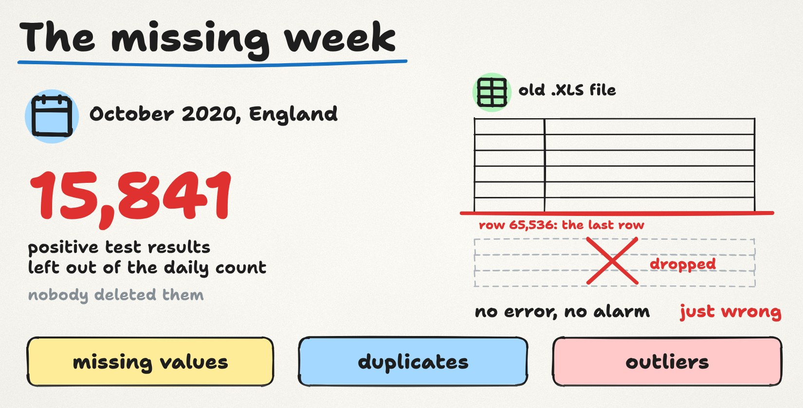

**First, last lesson's question.** A model scores 99% on its training data and 70% on new data. What went wrong? It overfitted: it learned the training examples, quirks and all, instead of the pattern. The first things to try are a simpler model, more training data, and a check that the new data looks like the data it learned from. And sometimes the cause is the data itself, which brings us to today.

## Garbage in, garbage out

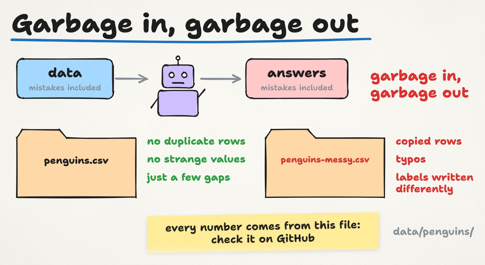

A model learns whatever is in the data, mistakes included. Data people have a short way of saying this: garbage in, garbage out.

Our penguin file from Lesson 0.2 is actually quite tidy: no duplicate rows, no strange values, just a few gaps. Real files are rarely that kind. So we made a practice copy, `penguins-messy.csv`, with the kinds of problems you'll meet at work: copied rows, typos, and labels written in different ways. Every number in this lesson comes from that file, and the [data README](https://github.com/datalyceum/course/blob/main/data/penguins/README.md#penguins-messycsv) lists every change we made, so you can check them all.

## Problem 1: missing values

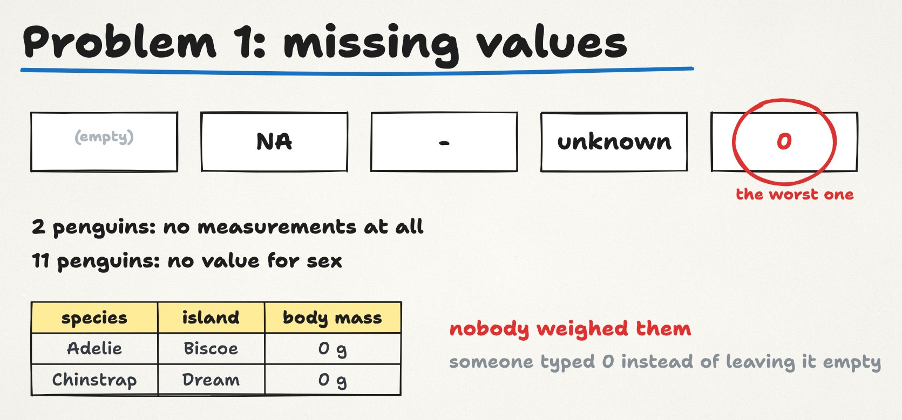

A missing value doesn't always look empty. It can be a blank cell, the letters NA, a dash, the word "unknown", or worst of all, a zero. A zero is the worst because it looks like a real measurement, so nothing warns you.

The real file has two penguins with no measurements at all, and eleven with no value for sex. In the messy copy, two penguins also weigh exactly 0 g. Nobody weighed them; someone typed 0 instead of leaving the cell empty.

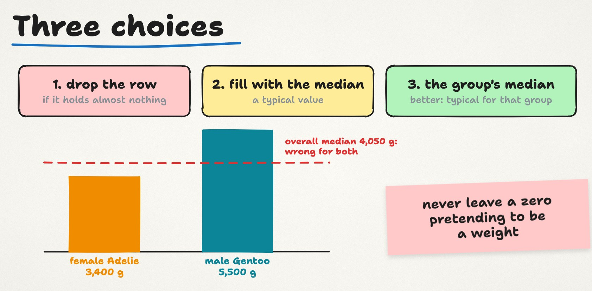

You have three choices:

1. **Drop the row** if it holds almost nothing, like the two penguins with no measurements.
2. **Fill the gap with a typical value,** such as the median.
3. **Better: fill it with the typical value for that group.** A female Adelie weighs around 3,400 g and a male Gentoo around 5,500 g. The overall median, 4,050 g, would be wrong for both.

Whatever you choose, never leave a zero pretending to be a weight. Turn fake zeros back into empty cells first, then decide.

## Problem 2: duplicates

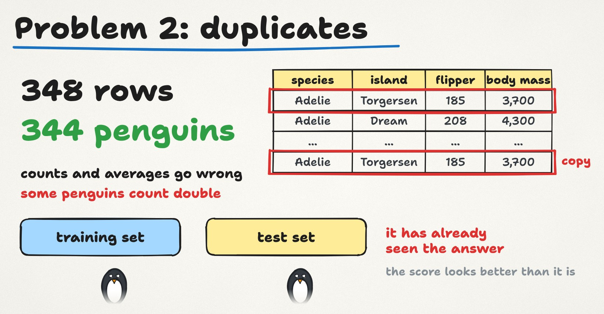

The messy file has 348 rows, but only 344 penguins. Four rows were copied twice.

That sounds harmless. It isn't. Counts and averages go wrong, because some penguins count double. For machine learning it's worse. Remember the hidden exam from Lesson 0.3? If the same penguin lands in both the training set and the test set, the model has already seen the answer, and the test score looks better than it really is. This is one kind of **data leakage**, and we come back to it in Season 3.

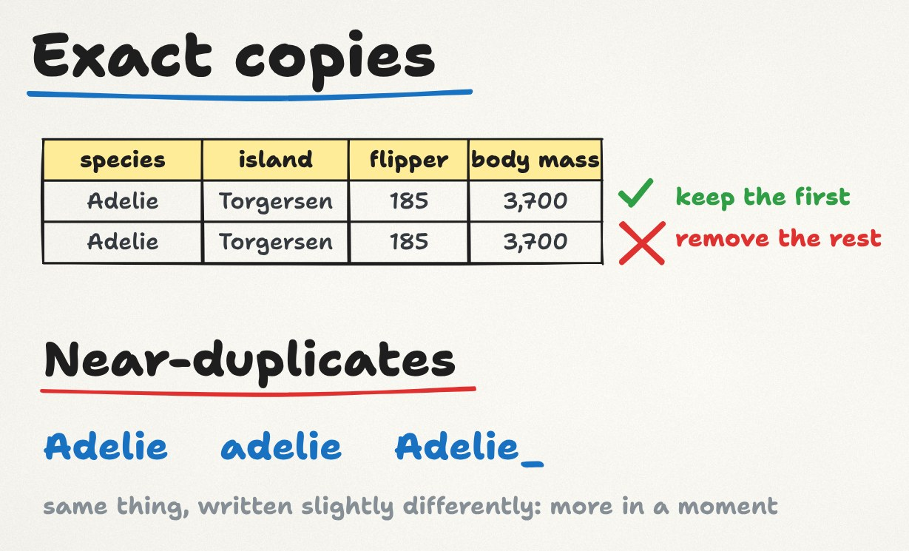

**Exact duplicates** are easy: every value is the same, so you keep the first copy and remove the rest. **Near-duplicates** are harder, because the same thing is written slightly differently. That's the labels problem below.

## Problem 3: outliers

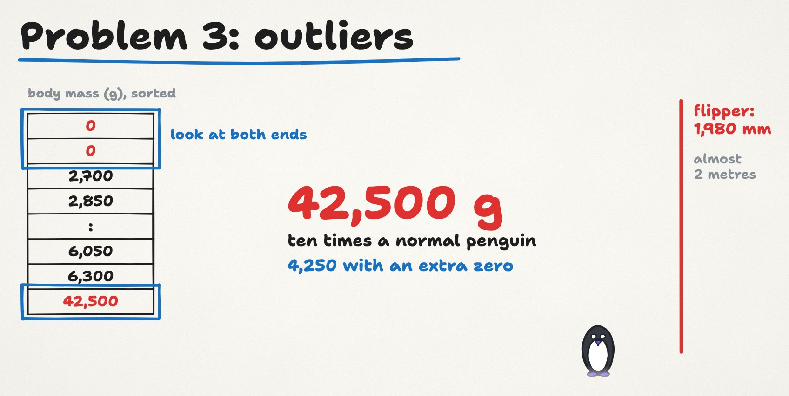

An outlier is a value far from the others. The quickest check is to sort a column and look at both ends.

In the messy file, the heaviest penguin weighs 42,500 g, ten times a normal penguin. Look closer and it's 4,250 with an extra zero. And one flipper is 1,980 mm long, almost two metres: 198 with an extra zero.

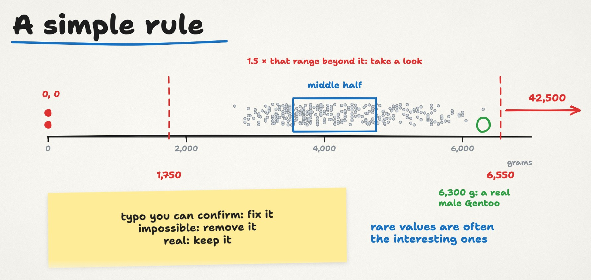

Data people use a simple rule to flag values like these:

1. Sort the column and take the middle half of the data. For the messy body mass, that's 3,550 to 4,750 g.
2. Measure that range: 1,200 g.
3. Go one and a half times that range beyond each end: 1,800 g below 3,550 and 1,800 g above 4,750.
4. Anything below 1,750 g or above 6,550 g deserves a look.

The rule catches the 42,500, and the two zeros as well. In the real file, the heaviest penguin is a male Gentoo at 6,300 g. Big, but inside the range, and real.

So an outlier is a question, not an automatic delete:

- **A typo you can confirm:** fix it.
- **An impossible value:** remove it.
- **A real value:** keep it. Rare values are often the interesting ones.

## Six species?

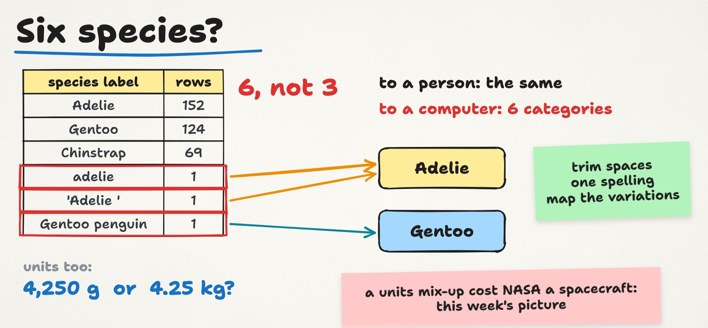

One more problem hides in plain sight. Count the species in the messy file and you get six, not three: Adelie, "adelie" with a small a, "Adelie " with an invisible space at the end, and "Gentoo penguin", next to Gentoo and Chinstrap.

To a person they're the same. To a computer, different text means a different category. The fix is to make labels consistent: remove extra spaces, use one spelling, and map the variations to the right name.

The same goes for units. If one column mixes grams and kilograms, the numbers can't be compared. That kind of mix-up once cost NASA a spacecraft: [Picture #3](/pictures/03-one-number-two-units/) tells the story.

## A cleaning routine

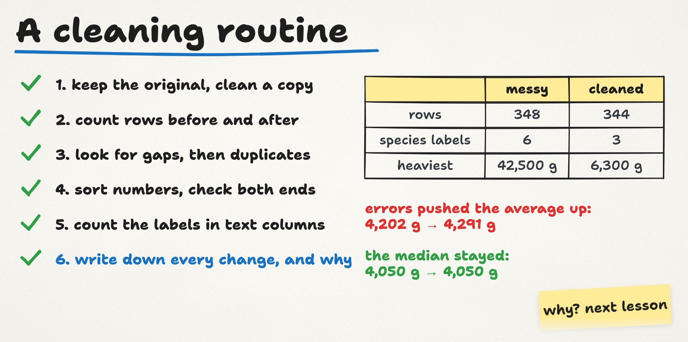

Here's a routine you can use on any file:

1. Keep the original untouched, and clean a copy.
2. Count the rows before and after.
3. Look for gaps, then for duplicates.
4. Sort each number column and check both ends.
5. Count the labels in each text column.
6. Write down every change you make, and why.

After cleaning, our messy file is back to 344 penguins, three species, and a heaviest penguin of 6,300 g.

One more thing to notice. The errors pushed the average body mass up from 4,202 g to 4,291 g. The median didn't move at all: it stayed at 4,050 g. We'll see why in Lesson 1.2.

## Common confusions

**"Missing values are always empty cells."** They can be NA, a dash, "unknown", 999 or 0. Before you count gaps, find out how this file writes "we don't know".

**"Just delete every row with a gap."** You'd lose real information, and if the gaps aren't random, you bias the data. In the penguin file, dropping every row without a sex would throw away 11 penguins, most of them with perfectly good measurements.

**"Fill every gap with the average."** One number for everyone hides real differences between groups, and an average is pulled around by outliers. The median of the right group is usually a better fill.

**"Outliers are errors, so delete them."** Some are errors, some are the most interesting rows in the file. Check before you delete, and write down what you did.

**"Duplicates only matter for counting."** They also leak answers from the training set into the test set and make a model look better than it is.

**"Cleaning is done once."** New data arrives with new problems. That's why it pays to save your cleaning steps so you can run them again, which is exactly what the Azure tools below do.

## A closer look at Azure

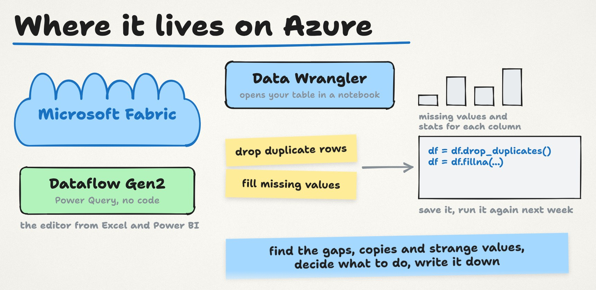

You don't need to remember these yet. We open them for real in the hands-on track.

- **Data Wrangler** runs inside notebooks in **Microsoft Fabric**. It opens a table and shows each column's missing values and summary statistics at a glance. You click cleaning steps, such as dropping duplicate rows, filling missing values or stripping whitespace, see a preview of each change, and Data Wrangler writes the matching Python code (pandas, or PySpark for Spark DataFrames). Add that code to your notebook and you can run the same cleaning again next week.
- **Dataflow Gen2**, also in Microsoft Fabric, does the same kind of cleaning without code, using the Power Query editor you may know from Excel and Power BI.

Either way, the ideas are the ones from this lesson: find the gaps, the copies and the strange values, decide what to do, and write it down.

A note on certifications: "handle duplicate, missing, and late-arriving data" is one of the skills measured in the Microsoft Fabric Data Engineer exam (DP-700).

## Try it yourself: clean the messy file (15 minutes, no code)

Download penguins-messy.csv (link below) and open it in Excel, Google Sheets or LibreOffice Calc. Save a copy first, and work on the copy.

1. **Count the rows.** You should have 348, plus the header.
2. **Duplicates.** Most spreadsheets have a "remove duplicates" tool (in Excel: Data → Remove Duplicates). Run it on all columns. It should remove 4 rows.
3. **Labels.** Turn on a filter for the `species` column and open the list. You'll see six values. Fix the three odd ones.
4. **Zeros and typos.** Sort `body_mass_g` and look at both ends, then do the same for `flipper_length_mm`. Decide what to do with the two zeros and the two values with an extra zero.
5. **Count again,** and write down every change and why.

Post what you found in the homework thread, and compare with the solutions a week later.

## Key terms

- **Dirty data:** data with errors, gaps or inconsistencies that can mislead an analysis or a model.
- **Missing value:** a value that wasn't recorded. It can look like a blank, NA, a dash or a fake zero.
- **Median:** the middle value when you sort the numbers. Half are below it, half above.
- **Duplicate:** a row that appears more than once. **Near-duplicate:** the same thing written slightly differently.
- **Outlier:** a value far from the others. It can be an error or a rare real value.
- **Data leakage:** information from the test set getting into training, so the test score looks better than it should.

## Check yourself and practise

<LessonLinks folder="01-data-foundations/01-dirty-data" thread={6} threadText="Post what you found in the messy file and what you did with each problem." post="https://datalyceum.substack.com/p/lesson-11-dirty-data" notebook="clean-penguins.ipynb" notebookText="Every cleaning step in pandas, with the numbers from the lesson. Optional." messy solutions />

**Question for next time:** the average penguin weighs 4,202 g. Is there really a typical penguin, when the file holds three species?

*Data: Palmer Penguins, collected by Dr. Kristen Gorman and the Palmer Station LTER program, CC0 (Horst, Hill and Gorman, 2020). The messy copy is ours, made for this lesson. The COVID story: [The Register](https://www.theregister.com/2020/10/05/excel_england_coronavirus_contact_error/), 5 October 2020. This is an independent course, not affiliated with or endorsed by Microsoft. Microsoft, Azure and Microsoft Fabric are trademarks of the Microsoft group of companies.*

---

Prefer email? The same notes, plus an example from a factory, are on [Substack](https://datalyceum.substack.com/p/lesson-11-dirty-data). Questions or homework answers go in [Discussions](https://github.com/datalyceum/course/discussions).
