import { YouTube } from '@astro-community/astro-embed-youtube';
import LessonLinks from '../../../components/LessonLinks.astro';

<YouTube id="L12VIDEO" title="Lesson 1.2: Averages and spread" />

Around 1950, the US Air Force measured 4,063 of its flying personnel. A researcher, Gilbert Daniels, took ten body measurements used to design clothing, such as height, chest and sleeve length, and worked out the average of each. Then he counted how many men were close to average on all ten. He was generous: close meant anywhere in the middle 30 percent. The answer was zero. Not one man was average on all ten. The average man was a number, not a person.

In this lesson you'll learn what an average tells you and what it hides: the mean and the median, how to measure spread, and how to read the shape of your data, all on the penguin data from Season 0.

The video is about 9 minutes, with audio in English, French, Spanish, Japanese and Hindi (on YouTube: Settings → Audio track). These notes add the details: the common confusions, a closer look at the Azure tools, and a fifteen-minute exercise you can do in any spreadsheet.

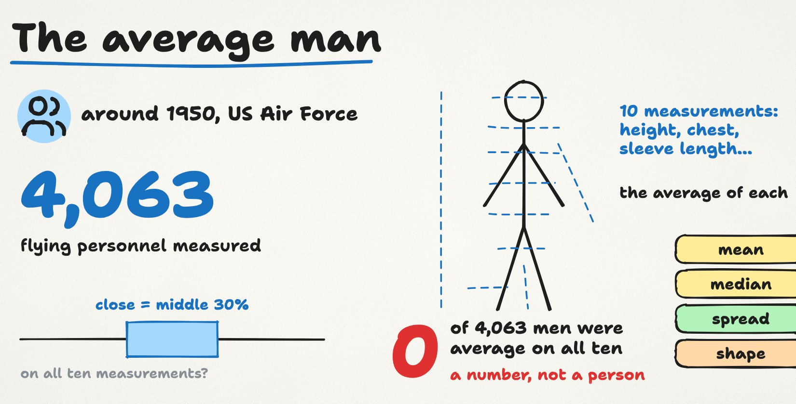

**First, last lesson's question.** The penguins weigh 4,202 g on average. Is there really a typical penguin? Not really. Only 25 of the 342 penguins weigh within 100 g of that average. The file mixes three species: Adelie and Chinstrap penguins weigh about 3,700 g, Gentoos about 5,100 g, and the average lands in the gap between them. An average across very different groups can describe almost nobody.

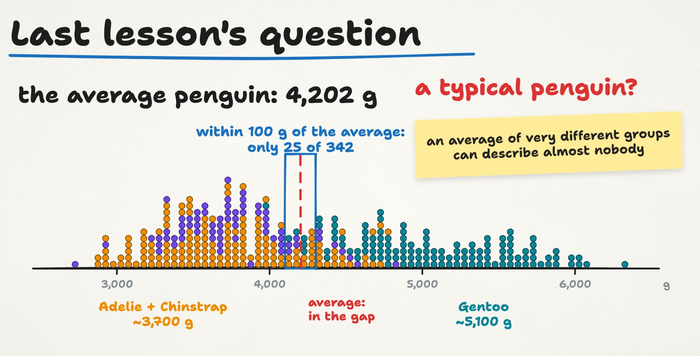

## Two kinds of middle

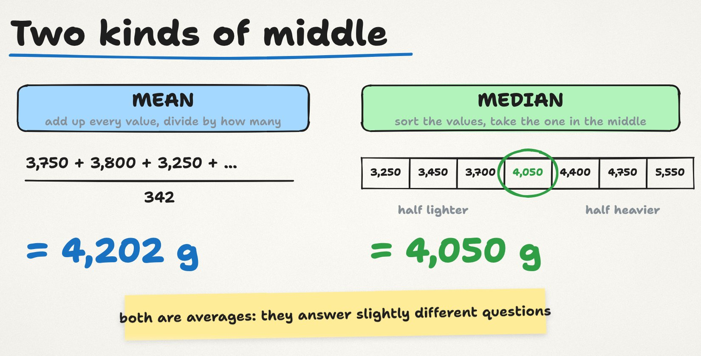

There are two common ways to find the middle of a column of numbers:

- **The mean** adds up every value and divides by how many there are. For the 342 penguins with a body mass, that's 4,202 g.
- **The median** sorts the values and takes the one in the middle. Half the penguins are lighter, half are heavier. That's 4,050 g.

When people say "average", they usually mean the mean. Both are averages; they answer slightly different questions. With an even number of values, like our 342, the median is halfway between the two middle values.

## One typo

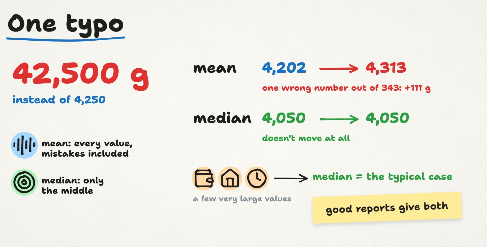

Remember the typo from [Lesson 1.1](/season-1/lesson-1-1-dirty-data/)? One penguin was written as 42,500 g instead of 4,250. Put that one value back in and the mean jumps from 4,202 to 4,313 g. One wrong number out of 343 moved it by more than 100 g. The median doesn't move at all: it stays at 4,050 g.

The mean listens to every value, mistakes included. The median only cares about the middle. So when a few values are very large, as with income, house prices or waiting times, the median shows the typical case better. [Picture #4](/pictures/04-why-the-average-can-lie/) shows the same thing with American family wealth: an average of $1.24 million, a median of $215,900. Good reports give both, and say which one they mean.

## Spread

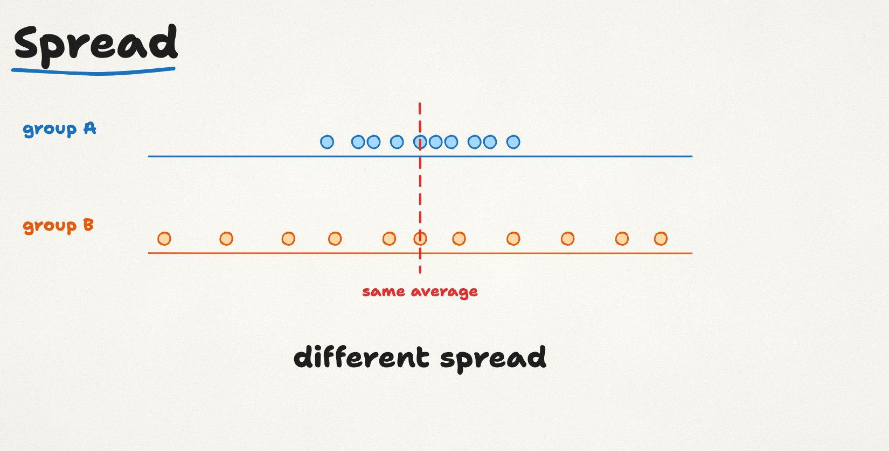

Two groups can share the same average and still be very different. That's why we also measure the spread: how far the values sit from the middle.

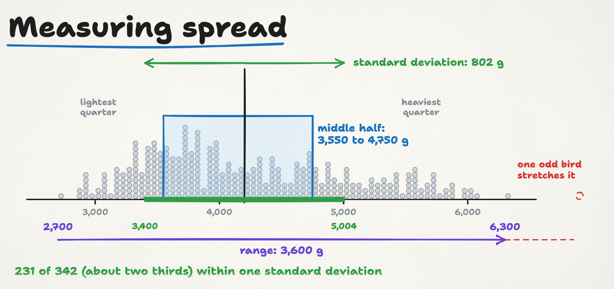

- **The range** is the biggest value minus the smallest. The lightest penguin weighs 2,700 g and the heaviest 6,300 g, a range of 3,600 g. It's simple, but it only looks at the two most extreme penguins, so one unusual bird can stretch it.
- **The middle half** is steadier. Sort the penguins and cut off the lightest quarter and the heaviest quarter. What's left runs from 3,550 to 4,750 g. Its width, 1,200 g, is called the **interquartile range** (IQR). You met it in Lesson 1.1, in the rule for spotting outliers.
- **The standard deviation** is a typical distance from the mean. For body mass it's 802 g. About two thirds of the penguins, 231 of them, weigh within one standard deviation of the mean, between 3,400 and 5,004 g.

For the standard deviation, a spreadsheet does the arithmetic: in Excel or Google Sheets, `STDEV.S`. If you're curious how it works: take each value's distance from the mean, square it, average the squares (dividing by one less than the count), and take the square root.

## Draw the shape

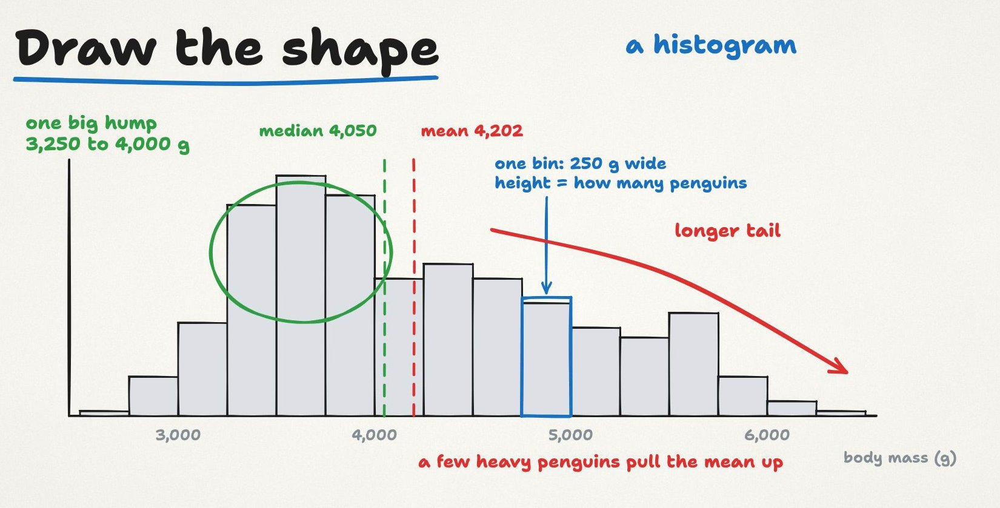

Numbers alone can't show you the shape. For that, draw a **histogram**: put the values into bins, here 250 g wide, and count how many penguins fall in each.

Body mass has one big hump, between about 3,250 and 4,000 g, and a longer tail on the heavy side. That long tail is why the mean sits about 150 g above the median: a few heavy penguins pull it up. When the tail is on the right like this, the data is called **right-skewed**.

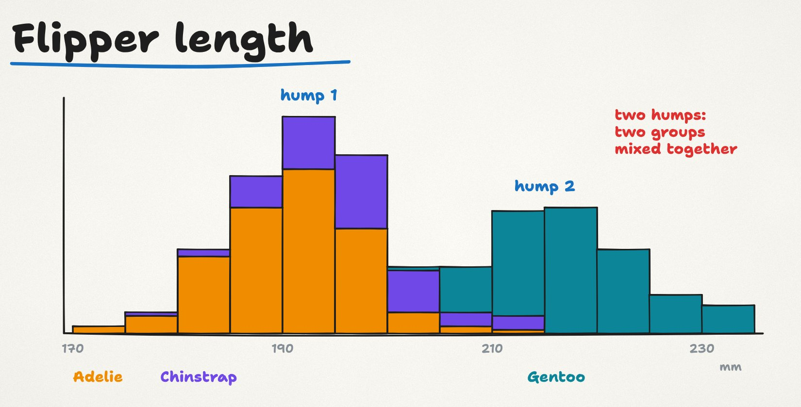

Flipper length looks different. It has two humps, one around 190 mm and another around 215 mm. Two humps usually mean two groups mixed together. Here, Adelie and Chinstrap penguins make the first hump and Gentoos the second. The average flipper, 201 mm, falls in the dip between them, where fewer penguins are.

## Split by group

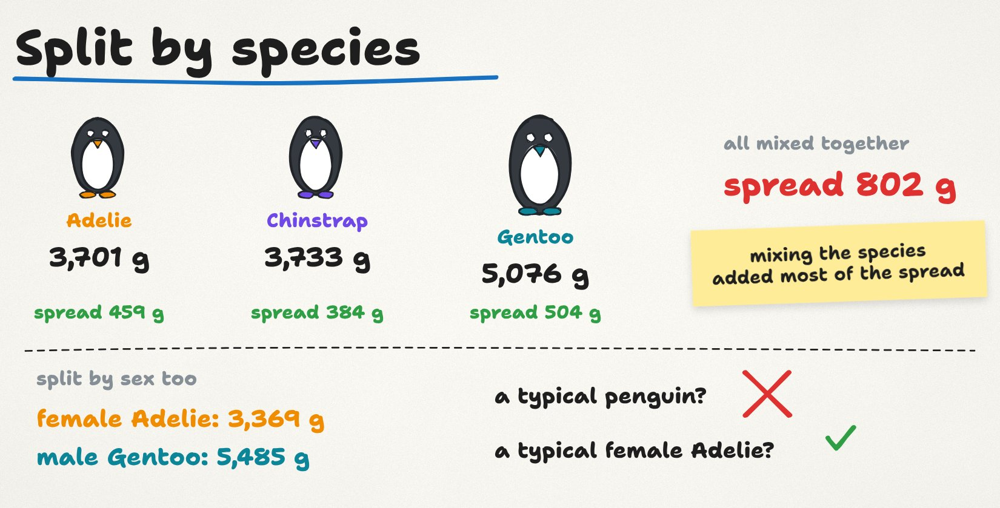

So split the penguins by species and measure again:

| Species | Penguins | Mean | Median | Standard deviation |
|---|---|---|---|---|
| Adelie | 151 | 3,701 g | 3,700 g | 459 g |
| Chinstrap | 68 | 3,733 g | 3,700 g | 384 g |
| Gentoo | 123 | 5,076 g | 5,000 g | 504 g |

Inside each species the standard deviation is about 400 to 500 g, not 802. Mixing the species added most of that spread. Split by sex as well and the groups get tighter still: a female Adelie averages 3,369 g and a male Gentoo 5,485 g.

So is there a typical penguin? No. But there is a typical female Adelie.

## A routine for any number column

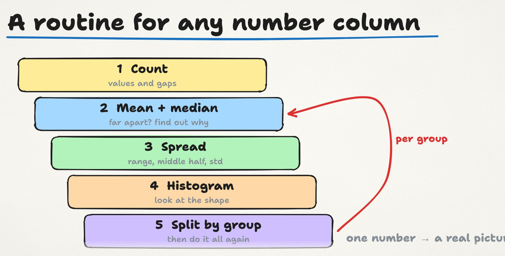

1. Count the values, and the gaps.
2. Find the mean and the median. If they're far apart, find out why.
3. Measure the spread: the range, the middle half and the standard deviation.
4. Draw a histogram and look at the shape.
5. Split by group and do it all again.

That's how you go from one number to a real picture of your data.

## Common confusions

**"Average means the mean."** In everyday speech, usually. But the median is an average too, and for skewed data like income or house prices it's often the better one. When you read "the average", ask which one.

**"The median ignores the data."** It uses every value to decide the order, then reports the middle one. That's exactly why one extreme value can't drag it around.

**"A big standard deviation means something is wrong."** It means the values are spread out. That can be real (three species in one file) or a sign of errors (a 42,500 g penguin). Look at the histogram to tell which.

**"The range is enough to describe spread."** It depends on only two values, the most extreme ones. The middle half and the standard deviation use the rest of the data.

**"One average describes the whole file."** Only if the file holds one kind of thing. Two humps in a histogram, or a mean far from the median, are signs to split by group first.

## A closer look at Azure

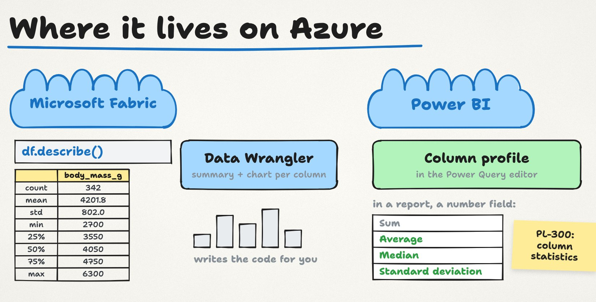

You don't need to remember these yet. We open them for real in the hands-on track.

- In a **Microsoft Fabric** notebook, one line of pandas, `df.describe()`, gives the count, mean, standard deviation, minimum, quartiles and maximum of every number column. **Data Wrangler** shows summary statistics and a chart for each column, and writes the code for every step you click.
- In **Power BI**, the Power Query editor can show column quality, column distribution and column profile while you prepare the data. The column profile includes the count, minimum, maximum, average and standard deviation of a number column, plus a value distribution.
- In a Power BI report, a number field is summed by default. In the visual's field menu you can switch it to the average, the median or the standard deviation.

A note on certifications: evaluating data, including data statistics and column properties, is one of the skills measured in the Power BI Data Analyst exam (PL-300).

## Try it yourself: describe flipper length (15 minutes, no code)

Download penguins.csv (link below) and open it in Excel, Google Sheets or LibreOffice Calc.

1. For the `flipper_length_mm` column, find the mean, the median, the smallest and largest value, and the standard deviation: `AVERAGE`, `MEDIAN`, `MIN`, `MAX` and `STDEV.S`. Remember the two empty rows.
2. Sort by species, or use a filter, and do the same for each species.
3. Are the mean and median close? Is the spread for each species smaller or bigger than for all penguins together? Why?
4. Bonus: draw a histogram of flipper length (in Excel: Insert → Chart → Histogram). How many humps do you see, and which species make each one?

Post what you found in the homework thread, and compare with the solutions a week later.

## Key terms

- **Mean:** the sum of the values divided by how many there are.
- **Median:** the middle value when you sort the numbers. Half are below it, half above.
- **Spread:** how far the values sit from the middle.
- **Range:** the biggest value minus the smallest.
- **Interquartile range (IQR):** the width of the middle half of the data, from the 25th to the 75th percentile.
- **Standard deviation:** a typical distance of the values from the mean.
- **Histogram:** a chart that counts how many values fall into each bin.
- **Skewed:** a distribution with a longer tail on one side. With a long right tail, the mean sits above the median.

## Check yourself and practise

<LessonLinks folder="01-data-foundations/02-averages-and-spread" thread={L12THREAD} threadText="Post your flipper numbers, or the column you described from your own data." post="L12POST" notebook="describe-penguins.ipynb" notebookText="Every step of the routine in pandas, with the numbers from the lesson. Optional." data />

**Question for next time:** penguins with longer flippers tend to be heavier. Does a long flipper make a penguin heavy? That's Lesson 1.3: correlation, causation, sampling and bias.

*Data: Palmer Penguins, collected by Dr. Kristen Gorman and the Palmer Station LTER program, CC0 (Horst, Hill and Gorman, 2020). The Air Force story: Gilbert S. Daniels, [The "Average Man"?](https://apps.dtic.mil/sti/tr/pdf/AD0010203.pdf), Technical Note WCRD 53-7, Wright Air Development Center, 1952. This is an independent course, not affiliated with or endorsed by Microsoft. Microsoft, Azure, Microsoft Fabric and Power BI are trademarks of the Microsoft group of companies.*

---

Prefer email? The same notes are on [Substack](L12POST). Questions or homework answers go in [Discussions](https://github.com/datalyceum/course/discussions).
